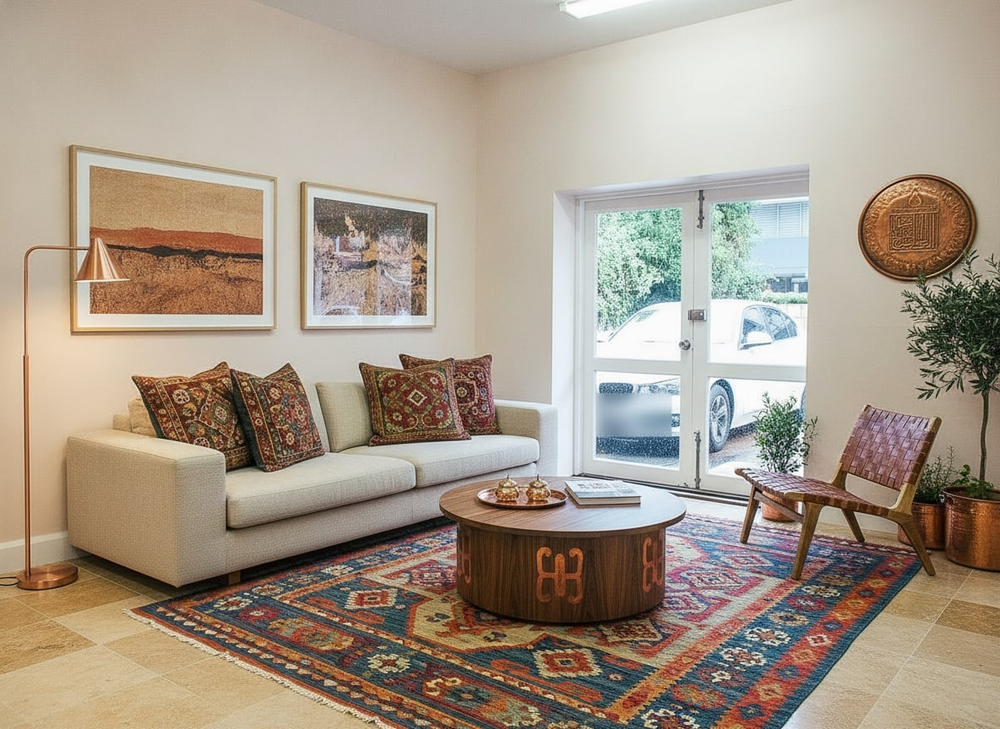

# AI Room

**Odanı saniyeler içinde yeniden tasarla.** Türkiye öncelikli, yapay zekâ destekli iç mekân, dış cephe ve
bahçe tasarım platformu. Fotoğraf yükle, stil seç, yapay zekâ yeniden tasarlasın. Ardından tasarımdaki
ürünlerin alışveriş listesini TL fiyat aralıklarıyla, tadilat bütçesini ve Türk mağazalarına giden linkleri al.

> Bu depo bir **MVP**'dir: beş bileşen uçtan uca çalışır. Rakip analizi ve yol haritası
> [docs/AI-Room-Pazar-Arastirmasi-ve-MVP-Raporu.pdf](docs/AI-Room-Pazar-Arastirmasi-ve-MVP-Raporu.pdf)
> dosyasında, API sözleşmesi [docs/API.md](docs/API.md) dosyasındadır.

| Önce (yerleşik örnek: gerçek oda fotoğrafı) | Sonra (Gemini 2.5 Flash Image · "Modern Türk") |
|---|---|
|  |  |

## Bileşenler

| Klasör | Ne | Teknoloji | Port |
|---|---|---|---|
| [`apps/backend`](apps/backend) | Ana API: kimlik, tasarımlar, kredi, görseller, admin uçları | NestJS 12 · Prisma 7 · PostgreSQL · Redis | 4000 |
| [`apps/ai-service`](apps/ai-service) | **Ayrı** AI servisi: görsel üretim, tasarım sohbeti, ürün/bütçe analizi | Python 3.13 · FastAPI · Gemini / Replicate (FLUX Kontext) / fal.ai (FLUX.2 klein + SAM 3) / mock · Claude | 8001 (yalnız iç ağ) |
| [`apps/web`](apps/web) | Kullanıcı web sitesi + stüdyo (BFF, httpOnly çerez) | Next.js 16 · Tailwind 4 | 3000 |
| [`apps/admin`](apps/admin) | Yönetim paneli (parola + TOTP MFA) | Next.js 16 · Tailwind 4 | 3001 |
| [`apps/mobile`](apps/mobile) | iOS / Android uygulaması (web önizleme dahil) | Expo SDK 58 · React Native 0.88 · Expo Router | 8081 |

```
Mobil ──Bearer──┐
Web ──cookie──> Web BFF ──Bearer──┤
Admin ──cookie──> Admin BFF ──────┤
                                  ▼
                     Backend (NestJS /v1) ──X-Internal-Token──> AI servisi (FastAPI)
                       PostgreSQL · Redis · görsel deposu        Gemini · Replicate · mock · Claude
```

## Özellikler (MVP)

- **10 AI aracı:** Anında Yenile, Boş Odayı Döşe, Nesne Sil / odayı boşalt, Değiştir, Duvar Boyası (10 hazır renk),
  Yeni Zemin (8 malzeme), Dış Cephe, Bahçe & Teras, Referans Stil (PRO), Kendi Tarifin (PRO).
- **15 stil**, aralarında yerel stiller de var: Modern Türk, Osmanlı Klasik, Ege, Akdeniz, Kapadokya Taş Ev ve
  Rustik Köy Evi. Stiller admin panelinden yönetilir.
- **12 oda türü**, Türkiye'ye özgü "Salon (Misafir)" ve "Balkon" dahil.
- **Önce/sonra kaydırıcısı**, 1–4 varyant, favoriler, indirme, paylaşım.
- **Alışveriş ve bütçe analizi:** ürünler, TL fiyat aralıkları, Trendyol / Hepsiburada / IKEA arama linkleri,
  tadilat kalemleri ve toplam bütçe.
- **AI tasarım sohbeti:** fotoğraf eklenebilir. Öneriler yalnız "dokun ve uygula" düğmesi olarak gelir; sohbet kendiliğinden üretim başlatmaz (AI-01).
- **Hesap güvenliği:** e-posta doğrulama ve şifre sıfırlama. Bağlantılar tek kullanımlıktır ve yalnız yapılandırılmış
  adresten üretilir; şifre sıfırlanınca tüm oturumlar kapanır. Geliştirmede e-postalar `apps/backend/data/outbox/`
  klasörüne yazılır, üretimde SMTP ile gönderilir.
- **Misafir modu:** günde 3 ücretsiz tasarım. Misafir hesap kayıtla yükseltilir ve tasarımlar korunur.
  PRO planı haftalık ₺149,99, aylık ₺349,99, yıllık ₺1.299,99 (şimdilik demo yükseltme).
- **Yapay zekâ etiketi:** ücretsiz plandaki sonuçlarda "Yapay zekâ ile oluşturulmuştur" yazısı bulunur
  (Türkiye reklam mevzuatı).
- **Admin paneli:** KPI'lar ve grafikler; kullanıcı yönetimi (askıya alma, plan, gerekçeli kredi);
  tasarım moderasyonu ve İlham galerisine öne çıkarma; stil editörü; denetim kaydı; sistem durumu.

## v1.1: backend ve AI servisi

- **İş kuyruğu (BullMQ, mevcut Redis üzerinde).** `POST /designs` varsayılan olarak senkron çalışır.
  `Prefer: respond-async` başlığıyla 202 döner; istemci `GET /designs/:id` ile durumu sorgular.
  `Idempotency-Key` aynı isteğin iki kez ücretlendirilmesini önler. 10 dakikadan uzun takılan işler toparlanır.
- **Kredi rezervasyonu.** Akış HELD → CAPTURED / RELEASED. Atomik çalışır, çift iade olmaz; kısmi sonuçta eksik varyantlar iade edilir.
- **AI maliyet defteri ve bütçe kesici.** Her çağrının sağlayıcısı, modeli, süresi ve USD maliyeti kaydedilir.
  Günlük bütçe aşılırsa FREE kullanıcıya tek varyant verilir ya da üretimi durdurulur; PRO etkilenmez.
- **Çalışma zamanı ayarları (admin API).** Günlük haklar, varyant sınırları, bütçe, bakım modu, duyuru ve AI onayı
  zorunluluğu panelden değişir. Gerekçe zorunlu ve her değişiklik denetim kaydına girer.
- **KVKK.** Sürümlü ve yalnız eklenerek tutulan onay kaydı; `GET /me/export` ile tüm veriyi JSON olarak indirme;
  gece çalışan temizlik işi (eski yüklemeler, token'lar, outbox).
- **AI içerik bildirimi.** Google Play'in üretken AI politikası için. Admin bildirimleri sonuçlandırır; öne
  çıkarmayı kaldırabilir ya da tasarımı silebilir.
- **AI servisi sağlamlaştırma.** Yedek sağlayıcı zinciri (`IMAGE_FALLBACKS`), sağlayıcı başına devre kesici, 150 sn süre
  bütçesi, yeniden denenebilir / denenemez hata ayrımı, fotoğraf kalite kapısı (`/quality`), "değişiklik yok"
  tespiti ve Türkçe metin normalizasyonu.
- **Gerçek abonelik (RevenueCat).**
  - Mobilde `react-native-purchases`; development ya da store build gerekir, Expo Go'da çalışmaz.
  - Backend'de imzası doğrulanan webhook ve abonelik durum tablosu.
  - Satın alma sonrası `POST /billing/sync`.
  - Kredi paketleri her mağaza işlemi için bir kez yüklenir.
  - Admin'de "Ödeme olayları" sayfasında eşleşmeyen ve başarısız olaylar yeniden işlenebilir.
  - Anahtar yoksa geliştirmede demo yükseltme kullanılır.
- **S3 / R2 görsel deposu.**
  - `STORAGE_DRIVER=s3` ile Cloudflare R2, AWS S3 ve MinIO desteklenir.
  - Kova özel kalır; istemciler yine imzalı backend URL'si kullanır.
  - Yerel görseller `npm run storage:migrate` ile kovaya taşınır.
- **Swagger / OpenAPI.**
  - Backend: <http://localhost:4000/docs>.
  - AI servisi: <http://localhost:8001/docs>.
  - Statik kopyalar: [`docs/openapi/`](docs/openapi).
  - Üretimde varsayılan olarak kapalı (`SWAGGER_ENABLED`, `ENV=production`).

## Hızlı başlangıç (yerel)

Gerekenler: Node 22 (mobil için ≥ 22.13; diğerleri Node 20.9+ ile de çalışır), Python 3.12+ ve
[uv](https://docs.astral.sh/uv/), PostgreSQL 15+, Redis 7+.

```bash
# 1) Backend
cd apps/backend
cp .env.example .env          # DATABASE_URL'i ve 4 sırrı doldurun (openssl rand -base64 48)
npm install
createdb ai_room
npx prisma migrate deploy
npm run db:seed               # 15 stil + TOTP'li admin; bilgiler data/admin-credentials.txt dosyasına yazılır
npm run build && npm run start:prod
```

```bash
# 2) AI servisi (INTERNAL_TOKEN = backend AI_INTERNAL_TOKEN)
cd apps/ai-service
cp .env.example .env
uv sync
uv run uvicorn app.main:app --port 8001
```

```bash
# 3) Web, admin, mobil
cd apps/web && npm install && npm run dev                 # http://localhost:3000
cd apps/admin && npm install && npm run dev               # http://localhost:3001
cd apps/mobile && npm install && npx expo start           # i = iOS simülatör, w = web
```

Admin girişi için TOTP kodu gerekir. Geliştirmede `cd apps/backend && npm run admin:otp` kodu üretir.
Gerçek kullanımda `data/admin-credentials.txt` içindeki `otpauth://` adresini bir kimlik doğrulayıcı
uygulamaya ekleyin.

**Docker:** `cp .env.example .env`, dosyayı doldurun, ardından `docker compose up --build`. (Compose dosyası
yazıldı ama bu makinede Docker olmadığı için çalıştırılarak denenmedi.)

### Gerçek AI sağlayıcıları

| Değişken | Etki |
|---|---|
| `IMAGE_PROVIDER=mock` | Anahtarsız, çevrimdışı renk dönüşümü. Akışların hepsi çalışır. Üretimde reddedilir. |
| `IMAGE_PROVIDER=gemini` + `GEMINI_API_KEY` | Gemini görsel düzenleme (`gemini-2.5-flash-image`, değiştirilebilir) |
| `IMAGE_PROVIDER=replicate` + `REPLICATE_API_TOKEN` | Replicate üzerinde FLUX.1 Kontext Pro |
| `IMAGE_PROVIDER=falai` + `FAL_KEY` | fal.ai üzerinde FLUX.2 [klein] 4B edit (görsel başına ~0,012 $) |
| `FAL_KEY` (hangi sağlayıcı olursa olsun) | **Bölge kilidi** (API.md §7.8): boya, zemin, değiştir ve hedefli silmede SAM 3 maskesi çıkarılır, çıktı yalnız maske içinde uygulanır. Pencere ve kapılar kullanıcının kendi pikselleriyle kalır. |
| `ANTHROPIC_API_KEY` | Claude ile gerçek tasarım sohbeti, alışveriş/bütçe analizi ve referans stil çözümleme. Model `claude-opus-5-5`; sunucu tarafı yedek model (`fallbacks: "default"`) açık. Anahtar yoksa deterministik demo yanıtları döner. |

## Testler

```bash
cd apps/ai-service && uv run pytest              # 45 test: iç token, prompt kaçışı, görsel doğrulama, yedek zincir, devre kesici, kalite, no_change, bölge kilidi, fal.ai, Sentry maskeleme
cd apps/backend && npm test                      # 44 test: TOTP, XFF/NET-03, MIME imzası, KEY-01, MAIL-01, bütçe kesici, webhook, push, admin rolleri, yedek kodlar, Apple/Google token, hesap bağlama, alan şifreleme, zorunlu güncelleme, Sentry maskeleme
node scripts/smoke.mjs                           # 104 uçtan uca kontrol (çalışan backend + AI servisi gerekir)
```

Uçtan uca smoke testi şunları kapsar:
- Kullanıcı akışı: misafir giriş, katalog, örnek yükleme, üretim, kota, PRO kilidi, analiz, sohbet.
- Admin rolleri ve MFA kurtarma: SUPPORT yetki sınırları, kendine yetki verme, yedek kodla tek seferlik giriş, MFA sıfırlama, denetim kaydı.
- Zorunlu güncelleme: eski iOS sürümüne 426 + mağaza bağlantısı, web ve güncel sürüm serbest, resmî olmayan mağaza bağlantısı reddi.
- Apple/Google girişi: nonce, doğrulanamayan token reddi, katı gövde, Apple bildirimi, bağlı yöntemler.
- Kuyruk + push: asenkron tasarım, "Tasarımın hazır" bildirimi, token taşıma, KVKK dışa aktarımında cihazlar.
- Görsel güvenliği: imzalı URL'yi değiştirme ve görsel olmayan dosya reddi (FIL).
- Yetkilendirme ve oturum: başka kullanıcının kaydına erişim (AZ-01) ve refresh token yeniden kullanımı (SES-05).
- Admin: kullanıcı token'ıyla admin API (TOK-02), admin TOTP ve kod tekrarı (AUT-01), istatistik,
  öne çıkarma, denetim kaydı.
- Hesap kurtarma: e-posta doğrulama, şifre sıfırlama, tek kullanım, yanlış amaç, sahte Host başlığı (MAIL-01),
  sıfırlama sonrası oturum iptali (SES-04).

## Güvenlik

Kontroller red-team kataloğundaki kimliklerle eşleştirildi; ayrıntı PDF raporunun "Güvenlik ve uyum" bölümünde.
- **Yükleme (FIL):** İmza ve MIME birlikte kontrol edilir. Dosya yeniden JPEG'e kodlanır; EXIF ve GPS silinir (KVKK).
  UUID ile saklanır ve 24 saatlik HMAC imzalı URL ile sunulur.
- **Kota (RES-01):** Redis'te atomik, çok boyutlu kotalar. Kredi düşümü satır kilidiyle yapılır, başarısız üretimde iade edilir.
- **Token'lar (TOK, SES):** JWT yalnız HS256; `iss`, `aud` ve `typ` doğrulanır, kullanıcı ve admin ayrı audience kullanır.
  Refresh token rotasyonlu, yeniden kullanımda tüm aile iptal edilir. Ban ve rol değişiminde `tokenVersion` ile anında iptal.
- **Apple/Google girişi (TOK-01/02/03/05):** Yalnız RS256 ID token; `iss`, `aud`, yaş ve tek kullanımlık nonce kontrol edilir.
  E-postayla hesap bağlama yalnız iki taraf da doğrulamışsa yapılır. Apple refresh token'ı AES-256-GCM ile şifreli saklanır, hesap silinince iptal edilir.
- **Hata izleme (LOG-02):** Sentry yalnız beklenmeyen hataları alır; kullanıcı, IP, gövde, çerez, sorgu ve yerel değişken gönderilmez,
  metinler maskelenir (e-posta, token, imzalı URL). Rapor kendi logumuza `requestId` ile bağlanır.
- **Admin (AUT-01):** Parola + TOTP zorunlu, aynı kod tekrar kullanılamaz. Her yazma işlemi denetim kaydına girer (LOG-01).
- **Tarayıcı (SES-01, WEB-03):** Web ve admin tarafında token tarayıcıya hiç gelmez (BFF + httpOnly çerez).
  Durum değiştiren isteklerde Origin kontrolü yapılır; CSP ve güvenlik başlıkları açık.
- **AI servisi (NET-04):** Dışarı kapalı; iç token sabit zamanlı karşılaştırılır. Model çıktısı güvenilmez sayılır ve
  katalogla filtrelenir (AI-01/02).
- **Açılış ve hata yönetimi (KEY-01, EXC-01):** Eksik ya da varsayılan sırla veya üretimde `mock` sağlayıcıyla
  uygulama açılmaz. Hatalarda genel yanıt döner (fail-closed), loglar redakte edilir.

## Durum ve sonraki adımlar

**Çalışan ve doğrulanan:**
- Yukarıdaki beş bileşen.
- Gerçek Gemini çağrısı: bir kez denendi, yaklaşık 9 saniyede yanıt geldi.
- Mock modda bütün akışlar.

**Henüz yok:**
- Gerçek SMTP sağlayıcısı ve SPF/DKIM/DMARC ayarı (kod hazır, `MAIL_TRANSPORT=smtp`).
- Gerçek R2/S3 kovası (kod hazır, sahte S3 sunucusuyla uçtan uca doğrulandı).
- Gerçek mağaza ürünleri ve RevenueCat hesabı (kod hazır; anahtarlar `.env` dosyalarına girilmeli). Web ödemesi (iyzico/PayTR).
- Fırça ile maske düzenleme.
- Çoklu fotoğraf tutarlılığı.
- LiDAR/RoomPlan ile ölçü.
- Gerçek perakendeci kataloğu eşleştirme; şu an arama linkleri kullanılıyor.
- Usta teklifi.
- Emlakçılar için toplu sanal döşeme.

Faz planı PDF raporundadır.
